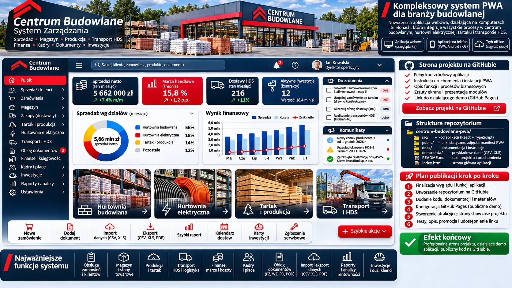
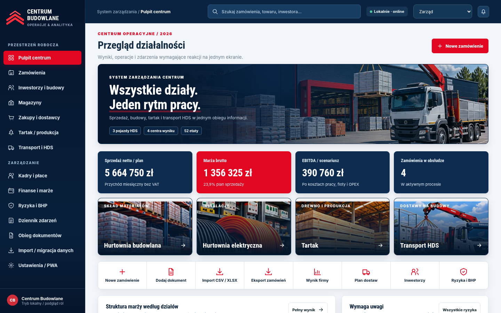
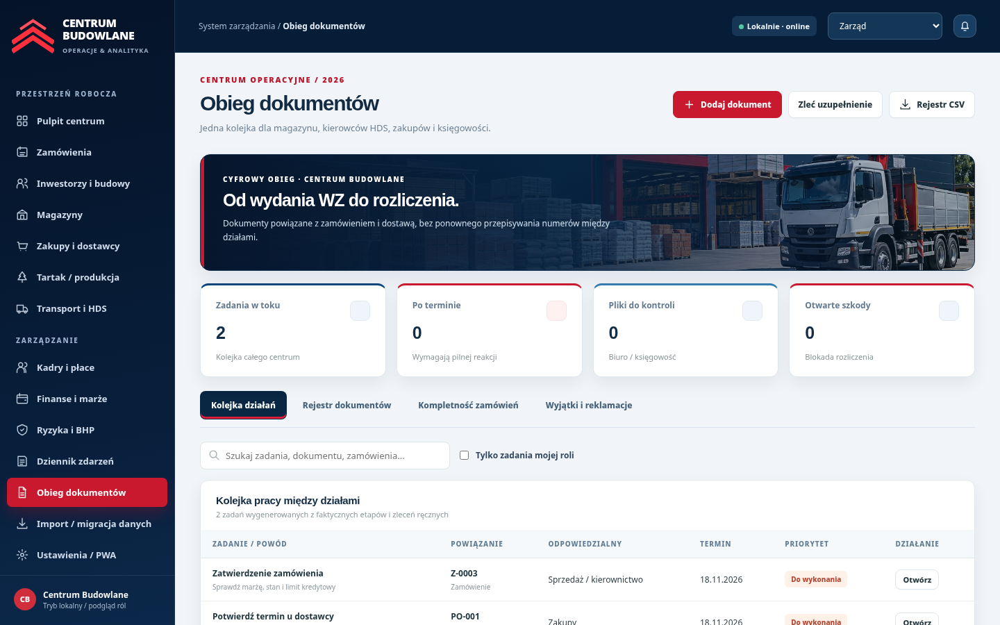

# Centrum Budowlane · Operacje

**Interaktywna aplikacja PWA i strona prezentacyjna projektu.** Model workflow dla dużego centrum budowlanego obejmującego hurtownię materiałów, hurtownię elektryczną, tartak oraz flotę HDS. Polski interfejs, przeglądarka desktop/mobile, 11 ról i demonstracyjny przepływ dokumentów.

> **Status:** demonstracja funkcjonalna na danych symulacyjnych. To nie jest gotowy wielostanowiskowy system ERP. Dane i pliki pozostają lokalnie w przeglądarce, a przełączanie ról nie jest uwierzytelnieniem ani zabezpieczeniem danych.

## Dwa punkty wejścia

| Ścieżka | Przeznaczenie |
|---|---|
| `/index.html` | Strona projektu: koncepcja, moduły, proces, galerie, role, technologie i CTA. |
| `/app/index.html` | Interaktywna aplikacja PWA: procesy, kartoteki, kalkulacje, załączniki i lokalny zapis. |

**Uruchomienie lokalne:** `python -m http.server 8080` uruchomione w głównym katalogu, następnie `http://localhost:8080/`. Na urządzeniu mobilnym użyj adresu HTTPS po publikacji.

## Zrzuty ekranów

**Grafika koncepcyjna wybrana do portfolio** (wizja systemu, dane symulacyjne):

Na stronie prezentacyjnej można otworzyć ten obraz w pełnym rozmiarze. Aplikacja i jej zrzuty ekranu pozostają odrębnymi, rzeczywistymi widokami demonstracji.

[Zobacz widok na telefonie](screens/Centrum_Budowlane_Dashboard_Mobile.png) · [Kompletność dokumentów](screens/Centrum_Budowlane_Kompletnosc_Dokumentow.png)

## Model finansowy Excel

Arkusz do pobrania: [Centrum Budowlane, model finansowy 2026](downloads/Centrum_Budowlane_Model_Finansowy_2026.xlsx). Zawiera założenia dotyczące wynagrodzeń, floty HDS, kosztów, marż, inwestorów, podatków i scenariuszy rentowności. Dane mają charakter symulacyjny. Arkusz udostępniono jako materiał edukacyjny do analizy scenariuszy, nie jako rzeczywisty model finansowy przedsiębiorstwa.

## Najważniejsze moduły

- Sprzedaż, wyceny i zamówienia B2B, w tym marżowanie oraz limity kredytowe inwestorów.
- Hurtownia budowlana, hurtownia elektryczna, magazyn, rezerwacje, PZ i WZ.
- Tartak: surowiec, produkcja, uzysk i koszt jednostkowy.
- Transport: HDS, dostawy, koszty floty i dokument POD od kierowcy.
- Obieg dokumentów: automatyczny rejestr, kolejka akceptacji, kompletność, obsługa szkód.
- Kadry i płace, symulacja kosztów, finanse, rentowność i ryzyka.
- Migracja CSV, TSV, XLSX i tabel HTML, eksport/import kopii JSON.

Szczegółowe informacje: [README aplikacji](app/README.md), [scenariusze testowe](app/SCENARIUSZE_TESTOWE.md), [źródła materiałów wizualnych](app/FOTOGRAFIE_I_LICENCJE.md).

## Publikacja przez GitHub Pages

1. Utwórz **nowe publiczne repozytorium** na GitHub, rekomendowana nazwa `centrum-budowlane-pwa`.
2. Wgraj **zawartość tego katalogu** do gałęzi `main`, zachowując foldery `.github`, `app` i `screens`.
3. Wejdź w **Settings → Pages → Build and deployment → Source → GitHub Actions**. Workflow `.github/workflows/pages.yml` opublikuje landing page oraz aplikację. [Instrukcja GitHub](https://docs.github.com/en/pages/getting-started-with-github-pages/configuring-a-publishing-source-for-your-github-pages-site).
4. Po publikacji link prezentacji powinien mieć format `https://lukaszst-cz.github.io/centrum-budowlane-pwa/`, a aplikacji `.../app/`. Konkretne URL-e sprawdź w Settings → Pages i Actions. Link GitHub Pages zostanie aktywowany po pierwszym wdrożeniu i konfiguracji Settings → Pages.
5. Po utworzeniu repozytorium zaktualizuj `showcase` link do kodu (obecnie prowadzi do profilu GitHub) oraz dodaj prawidłowy adres publiczny do opisu repozytorium i sekcji About.

### Zalecana karta repozytorium

**Description:** `Polska demonstracyjna aplikacja PWA dla centrum budowlanego: zamówienia, magazyn, tartak, HDS, dokumenty, marże i role.`

**Topics:** `pwa`, `construction`, `warehouse-management`, `document-workflow`, `logistics`, `javascript`, `erp-demo`, `polish`.

**About website:** po uruchomieniu GitHub Pages, publiczny adres strony prezentacyjnej.

## Testy przed publikacją

- Sprawdź działanie startowej strony i wszystkie odnośniki `./app/`.
- Przetestuj role i listę modułów, zamówienie, PO/PZ/WZ, tartak, POD, blokadę rozliczenia, CSV i import danych.
- Sprawdź orientację ekranu na telefonie i desktopie.
- Sprawdź PWA manifest/service worker na HTTPS i instalację na Androidzie oraz iOS.
- Testuj w profilu przeglądarki bez prawdziwych danych firmy, ponieważ zapis jest lokalny.

## Oprawa graficzna

Granat `#06152B`, czerwony `#C8192F`, biel i stalowe tła. Duży baner to wygenerowana **wizualizacja fikcyjnego składu budowlanego**. Kafle działów korzystają ze zdjęć Pexels ładowanych online i lokalnych teł zastępczych. Informacje o źródłach: [fotografie i licencje](app/FOTOGRAFIE_I_LICENCJE.md).

## Przed produkcyjnym użyciem

Niezbędne: serwerowa weryfikacja uprawnień, autentykacja, relacyjna baza danych z transakcjami i kontrolą współbieżności, szyfrowane repozytorium dokumentów, polityka retencji, kopie bezpieczeństwa, audyt działań, zgodność RODO, integracje ERP/KSeF i aktualizacja księgowo-podatkowego silnika kalkulacji.

Projekt demonstracyjny portfolio **Zielona Marka**. Brak powiązania z rzeczywistym przedsiębiorstwem lub potwierdzonego wdrożenia.

## System wizualny

Specyfikacja znajduje się w [`design-system/SYSTEM_WIZUALNY.md`](design-system/SYSTEM_WIZUALNY.md), interaktywny pokaz komponentów w [`design-system/index.html`](design-system/index.html). Tokeny są współdzielone między aplikacją i stroną prezentacyjną. Wersja oparta jest na grafice referencyjnej z rozmowy i nie stanowi rzeczywistego wdrożenia w hurtowni.

## Weryfikacja interfejsu, wersja 5

Sprawdzono pulpit, stronę prezentacyjną i system wizualny w rozmiarach 1440 px i 390 px. W testach przeglądarkowych nie wystąpiły błędy JavaScript ani poziome przepełnienie. Zweryfikowano globalne wyszukiwanie towaru, filtr hurtowni elektrycznej, utworzenie formularza nowego zamówienia, galerię ekranów i przełącznik ról. Ścieżki PWA wymagają osobnego testu instalacji na publicznym adresie HTTPS.

## Repozytorium źródłowe

Kod i pliki projektu: [github.com/lukaszst-cz/centrum-budowlane-pwa](https://github.com/lukaszst-cz/centrum-budowlane-pwa).
Po włączeniu GitHub Pages strona powinna być dostępna pod adresem: [lukaszst-cz.github.io/centrum-budowlane-pwa](https://lukaszst-cz.github.io/centrum-budowlane-pwa/). Aplikacja pod `/app/`.
